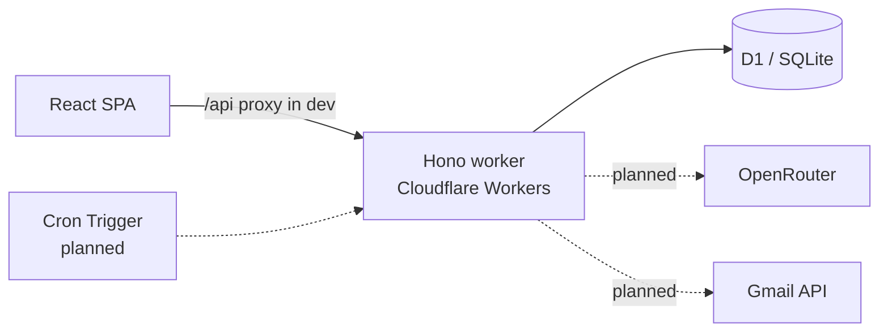

# MailPilot AI

AI email automation platform that connects multiple Gmail accounts, analyzes
messages with specialized AI agents, drafts replies for human approval, and
schedules delivery — with a dashboard for agent activity and analytics.

> **Status:** early development. The dashboard and a Hono/D1 demo API work
> locally. Gmail, OpenRouter, and AI agents are not implemented yet. See
> [Roadmap](#roadmap).

## Features

Working today:

- Responsive SaaS dashboard with sidebar navigation
- Dashboard overview cards, recent activity, category breakdown
- Inbox list with category filters (served from D1, or bundled demo data when
  the API is offline)
- Placeholder pages for scheduled emails, agent activity, analytics, settings
- Hono API on Cloudflare Workers: `GET /api/health`, `GET /api/emails`
- D1 schema and seed migrations for the full planned data model

Planned (not yet built):

- Multiple Gmail accounts via Google OAuth 2.0
- Classification, summarization, and reply-generation agents on OpenRouter
- Human-approved scheduled sending with Cloudflare Cron Triggers
- Agent run logging, token/cost tracking, and live analytics
- Public demo mode with fictional data

## Tech stack

| Layer | Choice |
| --- | --- |
| Frontend | React 19, TypeScript, Vite 8, Tailwind CSS 4, React Router 7, Lucide |
| Backend | Hono on Cloudflare Workers |
| Database | Cloudflare D1 (SQLite) with SQL migrations |
| AI (planned) | OpenRouter API, Zod-validated agent output |
| Email (planned) | Gmail API, Google OAuth 2.0 |
| Scheduling (planned) | Cloudflare Cron Triggers |
| Testing (planned) | Vitest |

## Architecture



One Worker serves both the built SPA (`dist/` via the assets binding) and the
API. `run_worker_first: ["/api/*"]` keeps API routes on the Worker; every other
path falls back to `index.html` for client-side routing.

## Getting started

Requires Node.js 20.19+ and npm.

```bash
npm install
npm run db:migrate:local   # create tables + fictional demo rows
npm run dev:api            # terminal 1: worker on http://localhost:8787
npm run dev                # terminal 2: Vite on http://localhost:5173
```

Open http://localhost:5173. Vite proxies `/api/*` to the Worker, so the app
talks to real D1 data. If the Worker is not running, the UI falls back to
bundled demo data and shows an amber notice.

Local D1 data lives in `.wrangler/` (git-ignored). Reset it by deleting that
folder and re-running the migration command.

## API

| Route | Purpose |
| --- | --- |
| `GET /api/health` | Worker + D1 connectivity check |
| `GET /api/emails` | Emails joined with their Gmail account, newest first |

Unknown `/api/*` paths return JSON `404`. Routes are scoped by account in SQL;
ownership checks become mandatory once real OAuth accounts replace demo rows.

## Database

SQL schema: `migrations/0001_init.sql`. Demo rows: `migrations/0002_seed_demo.sql`.

Tables: `users`, `gmail_accounts`, `email_records`, `agent_runs`, `drafts`,
`scheduled_emails`, `audit_events`. All email data hangs off `gmail_accounts`,
which belongs to a `users` row, so every query can enforce ownership.

```bash
npm run db:migrate:local     # apply migrations to local SQLite
npm run db:migrate:remote    # apply to the deployed D1 database
```

## Scripts

| Command | Purpose |
| --- | --- |
| `npm run dev` | Vite dev server with HMR |
| `npm run dev:api` | Hono worker via `wrangler dev` on port 8787 |
| `npm run build` | Type-check all tsconfigs, then build `dist/` |
| `npm run preview` | Serve the production build locally |
| `npm run lint` | Lint with oxlint |
| `npm run deploy` | Build, then `wrangler deploy` |

## Environment variables

None required yet. `.env*` and `.dev.vars` are git-ignored. Later secrets
(`OPENROUTER_API_KEY`, `GOOGLE_CLIENT_SECRET`, token-encryption key) belong in
Cloudflare secrets / `.dev.vars`, never in the browser or Git.

## Deployment

Not configured yet: `wrangler.jsonc` still has a placeholder `database_id`.
To deploy, create a real D1 database, paste its ID into `wrangler.jsonc`, run
`npm run db:migrate:remote`, then `npm run deploy`. The free tier is sufficient
for a demo; Gmail multi-account use at scale needs Google verification.

## Security notes

Demo data in `migrations/0002_seed_demo.sql` and `src/data/` is fictional. No
real email content, OAuth tokens, or API keys are stored in this repository.
Refresh tokens will be encrypted before storage. AI agents will never send
email without explicit human approval.

## Roadmap

1. Foundations — tooling, first app, GitHub repo ✅
2. Dashboard — Tailwind, layout, sidebar, inbox UI ✅
3. Backend — Hono, Cloudflare Workers, D1 migrations ✅
4. OpenRouter — model list, selector, inference
5. Agents — orchestrator, classification, summarization, reply
6. Gmail — OAuth, multi-account, manual sync
7. Scheduling — approval, cron sending, statuses
8. Analytics and testing
9. Deployment, demo mode, portfolio docs

## License

MIT
