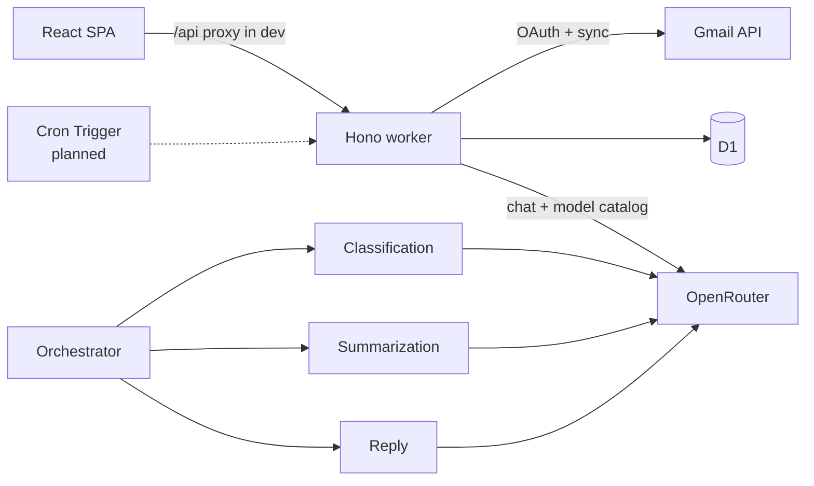

# MailPilot AI

AI email automation platform that connects multiple Gmail accounts, analyzes
messages with specialized AI agents, drafts replies for human approval, and
schedules delivery — with a dashboard for agent activity and analytics.

> **Status:** early development, running locally. Gmail OAuth and manual sync
> are implemented but not yet verified against live Google credentials.
> Scheduled sending is not implemented. See [Roadmap](#roadmap).

## Features

Working today:

- Responsive SaaS dashboard with sidebar navigation
- Inbox, email detail, category filters, priority badges
- OpenRouter model catalog with search, free-only filter, and per-user model
  selection (paid models disabled by default)
- Three specialized agents — classification, summarization, reply drafting —
  with JSON validation, one retry on invalid output, and per-run logging
- Agent Activity table: model, status, duration, tokens, estimated cost, errors
- Gmail OAuth connect/disconnect with read-only scope, AES-GCM encrypted
  refresh tokens, manual Sync Inbox (last 30 days, 25 messages per account)
- Hono API on Cloudflare Workers, D1 storage, SPA served from the same Worker
- Offline fallback to bundled demo data when the API is down

Planned (not yet built):

- Human-approved scheduled sending with Cloudflare Cron Triggers
- Live analytics charts
- Automated Google API integration tests
- Public demo mode and deployment

## Tech stack

| Layer | Choice |
| --- | --- |
| Frontend | React 19, TypeScript, Vite 8, Tailwind CSS 4, React Router 7, Lucide |
| Backend | Hono on Cloudflare Workers |
| Database | Cloudflare D1 (SQLite) with SQL migrations |
| AI | OpenRouter API, Zod-validated agent output |
| Testing | Vitest |
| Email (planned) | Gmail API, Google OAuth 2.0 |
| Scheduling (planned) | Cloudflare Cron Triggers |

## Architecture



One Worker serves the built SPA (`dist/`) and the API. `run_worker_first:
["/api/*"]` sends API paths to the Worker; other paths fall back to
`index.html`.

The orchestrator runs agents in order: classification, then summarization,
then reply. The reply agent receives the earlier outputs as context. Each step
is isolated — a failed step is logged and does not block the next one. Every
run is written to `agent_runs` with model, duration, tokens, and estimated cost.

## Getting started

Requires Node.js 20.19+ and npm.

```bash
npm install
npm run db:migrate:local
cp .dev.vars.example .dev.vars   # add OpenRouter + Google values
npm run dev:api                  # terminal 1: worker on :8787
npm run dev                      # terminal 2: Vite on :5173
```

Without `OPENROUTER_API_KEY` the app still works: models list loads (public
API), but agent runs return `openrouter_not_configured`.

### Gmail OAuth setup

1. Create a Google Cloud project and enable the Gmail API.
2. Configure the OAuth consent screen (External, Testing is fine) and add your
   Gmail address as a test user.
3. Create an OAuth client of type **Web application** with redirect URI
   `http://localhost:5173/api/gmail/callback` (change with `APP_URL` in
   production).
4. Put the client ID and secret in `.dev.vars`, and generate a token key:
   `TOKEN_ENCRYPTION_KEY=$(openssl rand -base64 32)`.
5. Restart the worker, open Settings, press Connect Gmail.

Scopes requested: `gmail.readonly` only. Sending is added when scheduling
lands, which may require re-consent. Google's Testing mode issues refresh
tokens that expire after 7 days, so expect to reconnect during development.
Accounts, tokens, and synced mail can be deleted from Settings.

Local D1 data lives in `.wrangler/` (git-ignored). Reset by deleting that folder
and re-running the migration command.

## Free-tier reality

- `openrouter/free` and `:free` models are heavily rate-limited; providers
  return `429` under load. The UI records those failures instead of hiding them.
- Free models often emit prose around JSON. Parsing is tolerant (first balanced
  object) and each agent retries once on invalid output.
- Paid models are blocked unless `ALLOW_PAID_MODELS=true`. Keep it off for $0.
- Cloudflare Workers, D1, and Cron Triggers have free allowances but a deployed
  multi-account Gmail app may need Google verification.

## API

| Route | Purpose |
| --- | --- |
| `GET /api/health` | Worker, D1, and OpenRouter key status |
| `GET /api/emails` | Emails joined with account, newest first |
| `GET /api/emails/:id` | Single email with body text |
| `GET /api/models?search=&freeOnly=true` | OpenRouter catalog, filtered |
| `GET /api/settings` | Selected model + paid-model flag |
| `PUT /api/settings/model` | Save model (rejects paid unless allowed) |
| `POST /api/agents/run` | Run all three agents for one email |
| `GET /api/agent-runs` | Latest 50 executions |
| `GET /api/gmail/status` | OAuth configured flag, redirect URI, account count |
| `GET /api/gmail/connect` | Start OAuth (PKCE + single-use state) |
| `GET /api/gmail/callback` | Exchange code, encrypt refresh token, save account |
| `GET /api/gmail/accounts` | Connected accounts with `connected` flag |
| `DELETE /api/gmail/accounts/:id` | Disconnect and delete synced mail |
| `POST /api/gmail/sync` | Refresh tokens and import recent messages |

Unknown `/api/*` paths return JSON `404`. There is no user authentication yet:
all routes operate as the seeded demo user `usr_demo`. Every Gmail query filters
by `user_id`, so ownership checks are already in the SQL.

## Database

Schema migrations in `migrations/`:

- `0001_init.sql`: `users`, `gmail_accounts`, `email_records`, `agent_runs`,
  `drafts`, `scheduled_emails`, `audit_events`
- `0002_seed_demo.sql`: fictional user, accounts, and emails
- `0003_settings.sql`: `settings` (selected OpenRouter model)

```bash
npm run db:migrate:local     # apply to local SQLite
npm run db:migrate:remote    # apply to the deployed D1 database
```

## Scripts

| Command | Purpose |
| --- | --- |
| `npm run dev` | Vite dev server with HMR |
| `npm run dev:api` | Hono worker via `wrangler dev` on :8787 |
| `npm run build` | Type-check all tsconfigs, then build `dist/` |
| `npm run test` | Vitest unit tests (mocked OpenRouter) |
| `npm run lint` | Lint with oxlint |
| `npm run deploy` | Build, then `wrangler deploy` |

## Testing

```bash
npm test
```

27 unit tests (Vitest): model pricing/filtering, tolerant JSON parsing, cost
estimation, Zod schema rejection, agent retry and failure isolation, OpenRouter
HTTP errors, AES-GCM round-trip and tamper rejection, PKCE derivation, OAuth URL
parameters, Gmail message/body mapping, and token refresh success/failure. No
network calls: `fetch` is mocked.

## Environment variables

| Name | Where | Purpose |
| --- | --- | --- |
| `OPENROUTER_API_KEY` | `.dev.vars` / Worker secret | Agent inference, paid-model list |
| `ALLOW_PAID_MODELS` | optional, default off | Allow selecting paid models |
| `GOOGLE_CLIENT_ID` | `.dev.vars` / Worker secret | Gmail OAuth client |
| `GOOGLE_CLIENT_SECRET` | `.dev.vars` / Worker secret | Gmail OAuth client |
| `TOKEN_ENCRYPTION_KEY` | `.dev.vars` / Worker secret | AES-GCM key for refresh tokens |
| `APP_URL` | optional | Public origin for OAuth redirects |

`.env*` and `.dev.vars` are git-ignored. Keys never reach the browser.

## Security notes

Demo data in `migrations/0002_seed_demo.sql` and `src/data/` is fictional. The
agents treat email content as untrusted data and are instructed to ignore
instructions inside it. Agents can only read one stored email; they cannot send
mail.

Gmail tokens are AES-GCM encrypted with `TOKEN_ENCRYPTION_KEY` before storage;
access tokens stay in worker memory only. OAuth uses PKCE plus single-use,
10-minute state rows bound to the user. Refresh tokens never reach the browser.
Sync and disconnect both filter by `user_id`.

## Roadmap

1. Foundations ✅
2. Dashboard ✅
3. Backend and D1 ✅
4. OpenRouter models and selection ✅
5. Agents and activity log ✅
6. Gmail — OAuth, encryption, multi-account, manual sync (code complete,
   live connection pending Google credentials)
7. Scheduling — approval, cron sending, statuses
8. Analytics and broader tests
9. Deployment, demo mode, portfolio docs

## License

MIT
